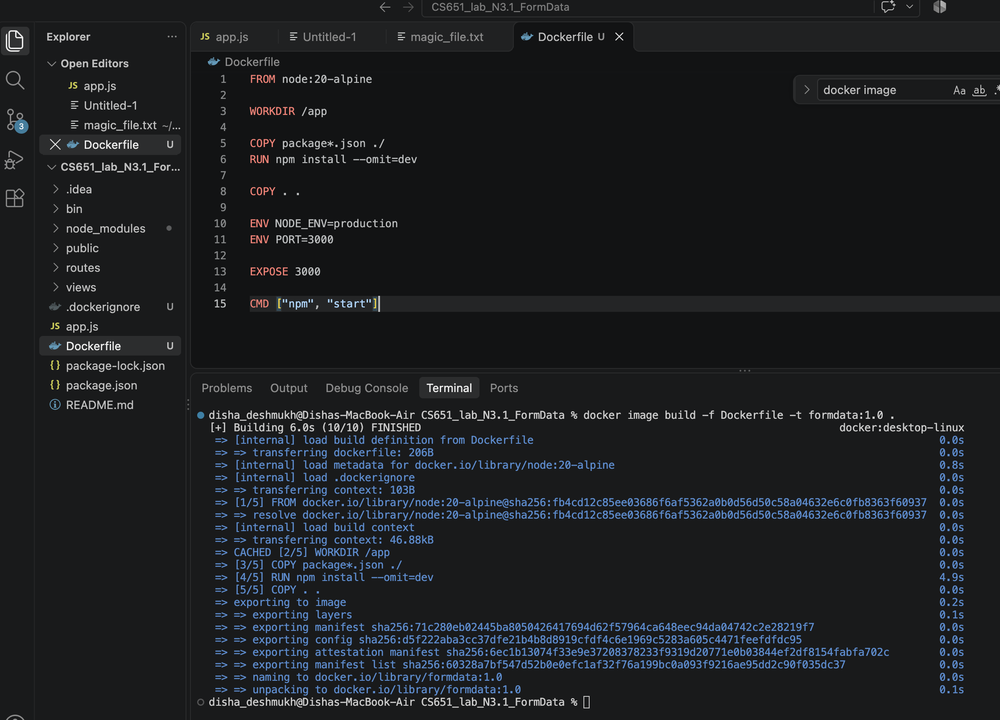
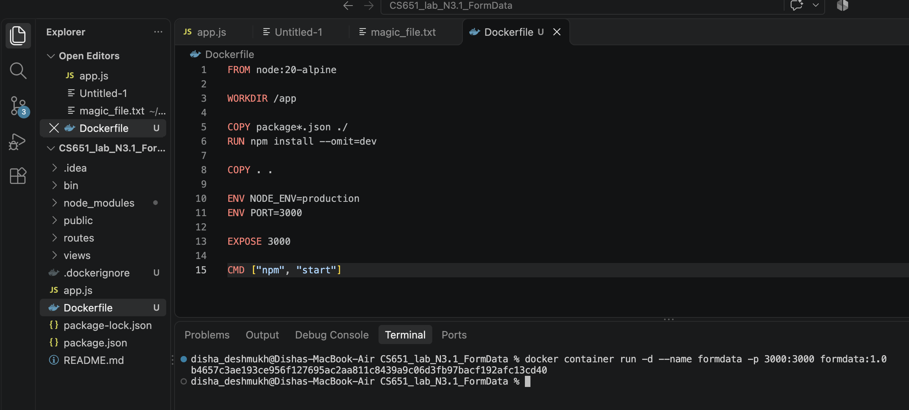
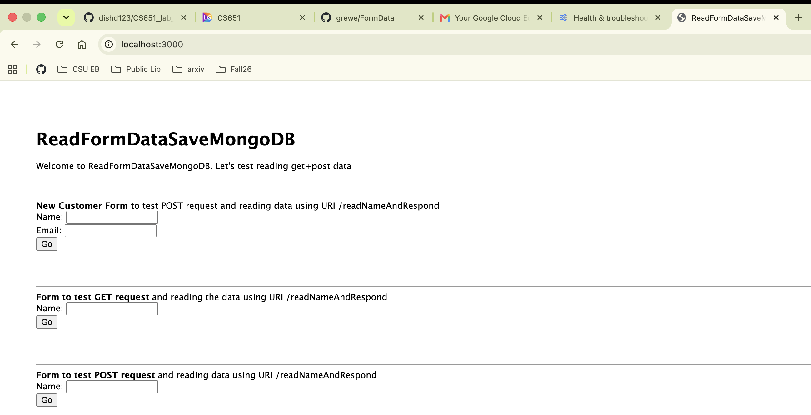
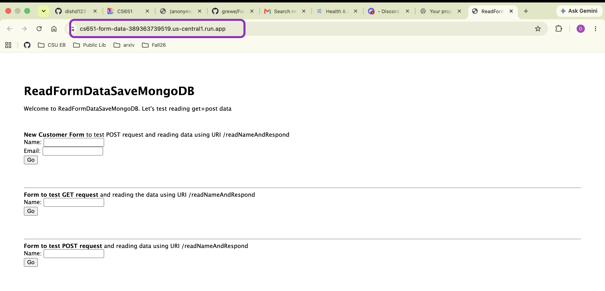
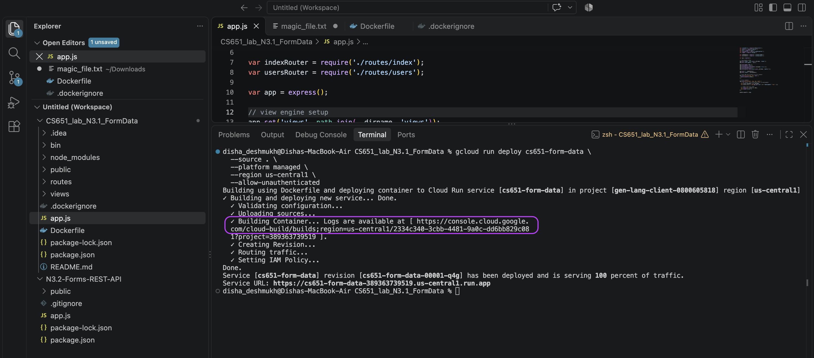

# NodeJS + Express (w/EJS) Code to exercise reading in form data and returning a response

This code has a / path (mapped to index.js --> index.ejs) which displays 3 forms each mapped to a different 
uri path in index.js that executes different controller code (for simplicity --as this is simple code, left controller
code in index.js rather than in the controllers directory --which is a better MVC code styling format).   Here is the interface


After hitting the Go button on the first form this is what the results will look like (notice it has read in the form data)


## Docker Configuration

The application is packaged as a Docker image using the `Dockerfile` in the project root:

```dockerfile
FROM node:20-alpine

WORKDIR /app

COPY package*.json ./
RUN npm install --omit=dev

COPY . .

ENV NODE_ENV=production
ENV PORT=3000

EXPOSE 3000

CMD ["npm", "start"]
```

The Dockerfile uses the lightweight Node.js Alpine image, installs the production dependencies, copies the application files, exposes port `3000`, and starts the Express server with `npm start`. The `.dockerignore` file excludes `node_modules`, Git files, the Dockerfile, and the README from the Docker build context.

### Build the Docker Image

From the project directory, build the image with:

```bash
docker image build -f Dockerfile -t formdata:1.0 .
```

The `-t formdata:1.0` option gives the image the name `formdata` and the tag `1.0`. The final `.` tells Docker to use the current directory as the build context.



### Run the Container Locally

Start a container from the image and map the host port to the application port:

```bash
docker container run -d --name formdata -p 3000:3000 formdata:1.0
```

The application is then available at [http://localhost:3000](http://localhost:3000).





## Google Cloud Run Deployment

The container was deployed to Google Cloud Run directly from the project source. Cloud Run used the Dockerfile to build the container and deployed it as the service `cs651-form-data` in the `us-central1` region.

The deployment command was:

```bash
gcloud run deploy cs651-form-data \
	--source . \
	--platform managed \
	--region us-central1 \
	--allow-unauthenticated
```

The options configure the deployment as follows:

- `--source .` uses the current project directory as the source.
- `--platform managed` deploys the service on the fully managed Cloud Run platform.
- `--region us-central1` deploys the service in the US Central region.
- `--allow-unauthenticated` allows users to access the website without signing in to Google Cloud.

After deployment, Google Cloud Run provided this service URL:

[https://cs651-form-data-389363739519.us-central1.run.app](https://cs651-form-data-389363739519.us-central1.run.app)




